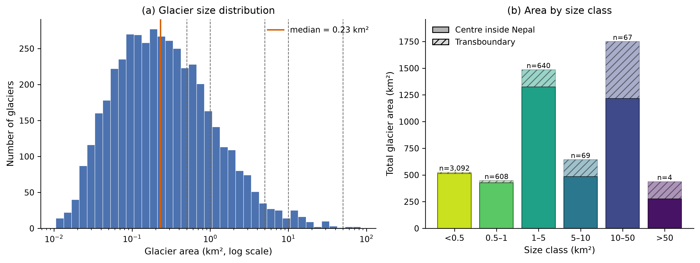
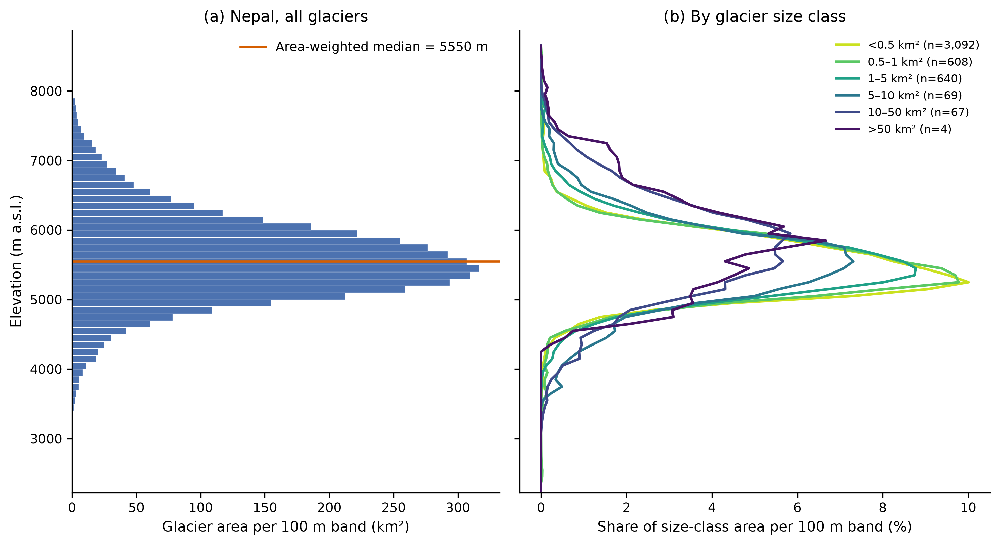
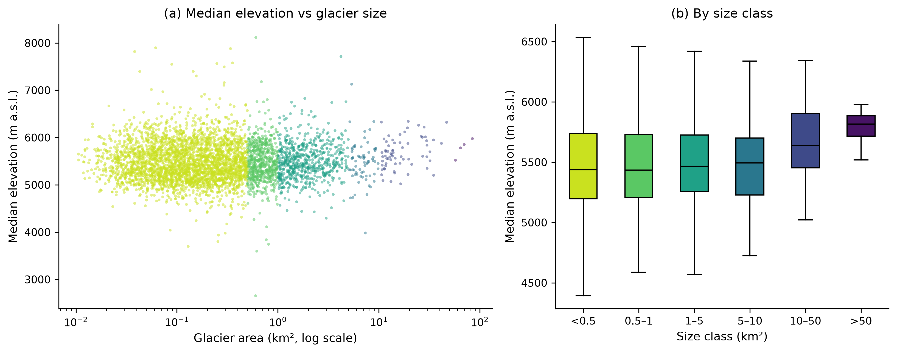
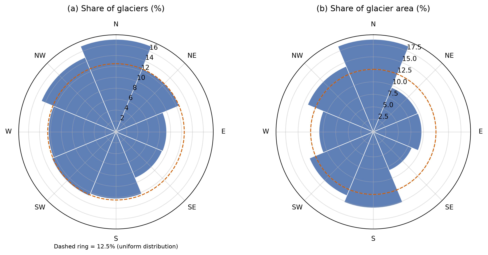
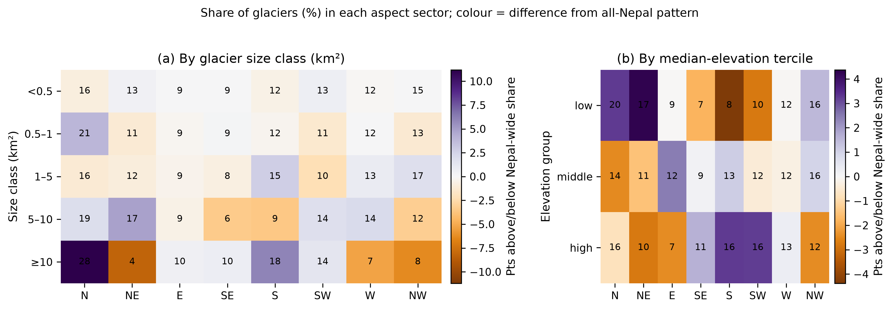

# Nepal Glacier Inventory and Hypsometry Explorer

Interactive map: https://biswashk920.github.io/nepal-glacier-explorer/

An analysis of glacier size, elevation and aspect in Nepal using the Randolph Glacier Inventory (RGI) 7.0, with an interactive web map.

## Research question

How are Nepal's glaciers distributed by size, elevation and aspect (the compass direction they face)?

The RGI is a snapshot with outlines dating from roughly 1992 to 2010. This analysis describes where the ice is and does not measure change.

## Main findings

1. Under the centre-point rule (see Methods), Nepal has 4,480 glaciers covering 4,245 km². A further 199 transboundary glaciers add 1,042 km² (about 25%). These totals depend on the boundary rule and the inventory dates, so they will differ from other published inventories of Nepal. (Table 1)
2. 82.6% of glaciers are smaller than 1 km² but hold only 22.2% of the area. The median glacier is 0.23 km². Half of the ice area is held by 172 glaciers (3.8%). (Table 1, Figure 1)
3. Half of the glacier area lies above 5,550 m. The 5th to 95th percentile range is 4,666 to 6,658 m, and area peaks in the 5,400 to 5,500 m band (7.5% of the total). (Figure 2)
4. Larger glaciers span a wider elevation range, from a median of 327 m for glaciers under 0.5 km² to 3,143 m for those over 50 km². Size correlates with terminus elevation (Spearman ρ = -0.38) and top elevation (ρ = +0.42) but not with median elevation (ρ = +0.02, not significant). Median elevation rises only in the largest size classes. (Table 2, Figure 3)
5. Aspect shows a weak preference. North is the most common sector (17.0% of glaciers). North-facing sectors (NW, N, NE) hold 44.2% of glaciers and south-facing sectors (SE, S, SW) hold 34.1%. The mean direction is about 319°, with low concentration (R = 0.11, where 0 means no preference and 1 means all glaciers face the same way). (Table 3, Figure 4)
6. Aspect varies weakly with elevation (Cramér's V = 0.128) and hardly at all with size class (V = 0.047, not significant). The lowest-elevation glaciers are the most north-facing (area-weighted mean 359°, R = 0.26). (Figure 5)

## Data

- **RGI 7.0**, glacier (G) product, regions 14 (South Asia West) and 15 (South Asia East): shapefiles plus attribute and hypsometry CSVs, from NSIDC-0770 (https://doi.org/10.5067/f6jmovy5navz). Used for outlines, area, elevation, aspect and area-elevation distributions.
- **geoBoundaries** Nepal ADM0 (https://www.geoboundaries.org): country boundary used to select glaciers.

No DEM was needed. RGI 7.0 includes a per-glacier area-elevation table (the hypsometry CSV files) in 50 m elevation bins.

**Citations**

RGI 7.0 Consortium, 2023. *Randolph Glacier Inventory - A Dataset of Global Glacier Outlines, Version 7.0.* Boulder, Colorado USA. NSIDC: National Snow and Ice Data Center. doi:10.5067/f6jmovy5navz

Runfola, D. et al., 2020. geoBoundaries: A global database of political administrative boundaries. *PLoS ONE* 15(4): e0231866.

## Methods

1. **Load and QA** (`01_data_qa`). Regions 14 and 15 were loaded and merged (56,149 glaciers). Checks covered CRS (EPSG:4326), duplicate IDs, invalid or empty geometries, nulls, impossible values (negative areas or elevations, minimum above maximum), and the date and DEM source of each outline. The only column with nulls was the glacier name.
2. **Selecting Nepal's glaciers.** A glacier belongs to Nepal if its RGI centre point (`cenlon`, `cenlat`, a point inside the outline) falls inside the Nepal boundary. Glaciers that overlap Nepal but have their centre point outside are flagged `transboundary` and reported separately. Outlines are never clipped, so area and median elevation always describe whole glaciers. Of the 4,480 glaciers, 10 are from region 14 and the rest from region 15.
3. **Areas.** Areas were recomputed in an Albers equal-area projection centred on Nepal (`+proj=aea +lat_1=27 +lat_2=30 +lat_0=28.5 +lon_0=84`). They agree with the RGI `area_km2` to within 0.002%, so the RGI values are used throughout.
4. **Size classes** (`02_size_classes`). Classes in km²: <0.5, 0.5-1, 1-5, 5-10, 10-50, >50 (lower bound included). Counts, area and summary statistics per class, plus a sensitivity test that includes all overlapping glaciers.
5. **Hypsometry** (`03_hypsometry`). The RGI hypsometry CSV gives each glacier's area in 50 m elevation bins as per-mille of its total area (each row sums to 1000). This unit is inferred, not documented in the files. I checked it by rebuilding each glacier's mean elevation from the bins, which matches the `zmean_m` attribute to within about 1 m (maximum difference 15 m). Bins were multiplied by glacier area to get km² and summed for regional curves. Area-weighted percentiles are interpolated within bins.
6. **Aspect** (`04_aspect`). `aspect_deg` was binned into eight 45° sectors (N = 337.5° to 22.5°, and so on), which matches the RGI `aspect_sec` code exactly. Circular means and the mean resultant length R were computed, area-weighted where stated. Dependence on size class and on elevation tercile (by median elevation: <5,285 m, 5,285-5,629 m, >5,629 m) was tested with chi-square tests, with Cramér's V as the effect size.
7. **Web map** (`05_webmap`). Outlines were simplified to a 30 m tolerance (in the equal-area projection) and exported with Folium to a single HTML file.

## Results

### Glacier size

**Table 1. Size classes for glaciers with their centre point inside Nepal (n = 4,480; 4,245 km²)**

| Size class (km²) | Glaciers | % of glaciers | Area (km²) | % of area | Increase in class area if transboundary glaciers are included |
|---|---:|---:|---:|---:|---:|
| < 0.5 | 3,092 | 69.0 | 513 | 12.1 | +2.2% |
| 0.5-1 | 608 | 13.6 | 427 | 10.1 | +4.5% |
| 1-5 | 640 | 14.3 | 1,325 | 31.2 | +12.0% |
| 5-10 | 69 | 1.5 | 486 | 11.4 | +32.4% |
| 10-50 | 67 | 1.5 | 1,217 | 28.7 | +43.7% |
| > 50 | 4 | 0.1 | 276 | 6.5 | +58.4% |

Mean glacier size is 0.95 km² and the median is 0.23 km². The 90th and 99th percentiles are 1.79 and 13.2 km², and the largest glacier is 84.5 km². The area-weighted median size is 4.2 km², so half of the ice is in glaciers smaller than that. The 10 largest glaciers hold 11.8% of the area.

The boundary rule matters little for small glaciers and a lot for large ones: two of the six glaciers over 50 km² that overlap Nepal have their centre point outside it.



*Figure 1. (a) Glacier size distribution (log scale). (b) Total area by size class, with transboundary glaciers hatched. The n labels in (b) count only glaciers with their centre point inside Nepal.*

### Elevation



*Figure 2. (a) Glacier area per 100 m elevation band, with the area-weighted median. (b) Distribution of each size class's area across elevation.*

| Elevation threshold | Share of glacier area above it |
|---|---:|
| 5,000 m | 86.4% |
| 5,500 m | 53.6% |
| 6,000 m | 21.8% |
| 6,500 m | 7.1% |

Only 0.64% of the area (27 km²) lies below 4,000 m. Including transboundary glaciers raises the area-weighted median by 39 m (5,550 to 5,589 m), so the elevation results are not sensitive to the selection rule.

**Table 2. Elevation by size class (per-glacier medians, m a.s.l.)**

| Size class (km²) | Glaciers | Terminus (min) | Median elevation | Top (max) | Elevation range |
|---|---:|---:|---:|---:|---:|
| < 0.5 | 3,092 | 5,248 | 5,438 | 5,634 | 327 |
| 0.5-1 | 608 | 5,091 | 5,435 | 5,840 | 713 |
| 1-5 | 640 | 4,931 | 5,466 | 6,104 | 1,092 |
| 5-10 | 69 | 4,666 | 5,493 | 6,615 | 1,998 |
| 10-50 | 67 | 4,458 | 5,639 | 7,138 | 2,688 |
| > 50 | 4 | 4,546 | 5,817 | 7,791 | 3,143 |

Larger glaciers reach lower at the terminus and much higher at the top. Median elevation rises only for the largest classes, so across all sizes the correlation is negligible.



*Figure 3. (a) Median elevation against glacier area. (b) Median elevation by size class.*

### Aspect

**Table 3. Glaciers and area by aspect sector**

| Sector | Glaciers | % of glaciers | Area (km²) | % of area |
|---|---:|---:|---:|---:|
| N | 760 | 17.0 | 785 | 18.5 |
| NE | 560 | 12.5 | 407 | 9.6 |
| E | 415 | 9.3 | 410 | 9.7 |
| SE | 410 | 9.2 | 353 | 8.3 |
| S | 550 | 12.3 | 644 | 15.2 |
| SW | 569 | 12.7 | 585 | 13.8 |
| W | 554 | 12.4 | 459 | 10.8 |
| NW | 662 | 14.8 | 601 | 14.2 |

An even spread would give 12.5% per sector. The mean aspect is 319° per glacier and 301° area-weighted, with R = 0.11 and 0.10.



*Figure 4. Aspect as a share of glaciers (a) and of glacier area (b). The dashed ring marks a uniform distribution (12.5%).*



*Figure 5. Share of glaciers (%) per aspect sector for each size class and elevation tercile. Colour shows the difference from the all-Nepal pattern.*

| Test | χ² | Cramér's V | Reading |
|---|---:|---:|---|
| Aspect vs size class | 40.3 (p = 0.06) | 0.047 | no meaningful relationship |
| Aspect vs elevation tercile | 147.3 (p = 2.5e-24) | 0.128 | small but clear |

Summary tables are also saved as CSV files in `outputs/tables/`.

## Limitations

- **Inventory dates vary.** Outlines date from 1992 to 2010. About 86% are from 1992 to 2002 and 1994 is the largest single year (29%), so the results describe a mixed-date snapshot.
- **Outline uncertainty.** Outlines come from many analysts and images. Small, snow-covered or shaded glaciers are the hardest to map, and debris-covered ice is difficult to delineate, so areas and terminus elevations of debris-covered glaciers are less certain. This analysis does not correct for it.
- **No change analysis.** The RGI is a snapshot and cannot show whether glaciers are growing or shrinking.
- **Boundary rule.** The centre-point rule gives 4,245 km²; counting every overlapping glacier gives 5,286 km². The largest size classes are the most sensitive. Border alignment in remote areas, including the disputed far west, was not independently checked.
- **Hypsometry resolution.** Area-elevation data are in 50 m bins stored as per-mille of glacier area. Medians rebuilt from the bins can differ from the RGI `zmed_m` by up to about 27 m, so the RGI attributes remain the primary median values.
- **Elevation source.** Elevations come from the Copernicus DEM (30 m for 4,611 overlapping glaciers, 90 m for 68), so DEM artefacts are possible. The lowest glacier (0.6 km², terminus at 2,439 m) sits far below all others and may be an outline or DEM artefact. It does not affect the percentiles.
- **Aspect.** Aspect is one number per glacier. Large glaciers curve and face several directions, and aspect for very small glaciers is noisy. The patterns are descriptive and do not show causes such as solar shading.
- **Small samples.** Only four glaciers are larger than 50 km², so statistics for that class are fragile.
- **Statistics.** Chi-square and Spearman p-values assume independent samples, but neighbouring glaciers share climate and terrain, so the p-values are overstated. The effect sizes are the numbers to rely on.
- **Web map.** The map uses simplified outlines to keep the file small. All reported statistics use the original geometries and attributes.

## Repository structure

```
nepal-glacier-explorer/
├── data/                  # not committed; see "Reproducing the analysis"
│   ├── raw/
│   │   ├── rgi7/          # RGI 7.0 regions 14 and 15 (unzipped)
│   │   └── boundary/      # geoBoundaries Nepal ADM0
│   └── processed/         # created by notebook 01
├── notebooks/
│   ├── 01_data_qa.ipynb
│   ├── 02_size_classes.ipynb
│   ├── 03_hypsometry.ipynb
│   ├── 04_aspect.ipynb
│   └── 05_webmap.ipynb
├── scripts/
│   └── glacier_utils.py   # shared paths, size classes, plot style
├── outputs/
│   ├── figures/           # PNG (300 dpi) and SVG
│   └── tables/            # CSV summary tables
├── docs/
│   └── index.html         # interactive map (GitHub Pages)
├── environment.yml
└── README.md
```

## Reproducing the analysis

The analysis runs on a normal laptop. The commands below are for Anaconda Prompt on Windows. Developed with Python 3.11; package versions are listed in `environment.yml`.

**1. Get the code and create the environment**

```
git clone https://github.com/biswashk920/nepal-glacier-explorer.git
cd nepal-glacier-explorer
conda env create -f environment.yml
conda activate nepal-glaciers
```

**2. Download the data** (not included in this repository)

- RGI 7.0 glacier (G) files for regions 14 and 15 from NSIDC-0770 (https://doi.org/10.5067/f6jmovy5navz). A free NASA Earthdata login is required. Unzip them to get:
  `data/raw/rgi7/RGI2000-v7.0-G-14_south_asia_west/` and `data/raw/rgi7/RGI2000-v7.0-G-15_south_asia_east/`
- geoBoundaries Nepal ADM0 from https://www.geoboundaries.org, unzipped into:
  `data/raw/boundary/geoBoundaries-NPL-ADM0-all/`

**3. Run the notebooks in order** (VS Code or JupyterLab, kernel `nepal-glaciers`)

`01_data_qa`, `02_size_classes`, `03_hypsometry`, `04_aspect`, `05_webmap`

Notebook 01 creates the files in `data/processed/` that the later notebooks need. Notebook 05 writes `docs/index.html`.

## Acknowledgements

Glacier data: RGI 7.0 Consortium (2023). Boundary: geoBoundaries. Map basemaps: Esri, OpenStreetMap contributors and OpenTopoMap, each under its own terms of use.

## Author

Biswash Kaphle, civil engineer (hydrology and flood risk), Nepal